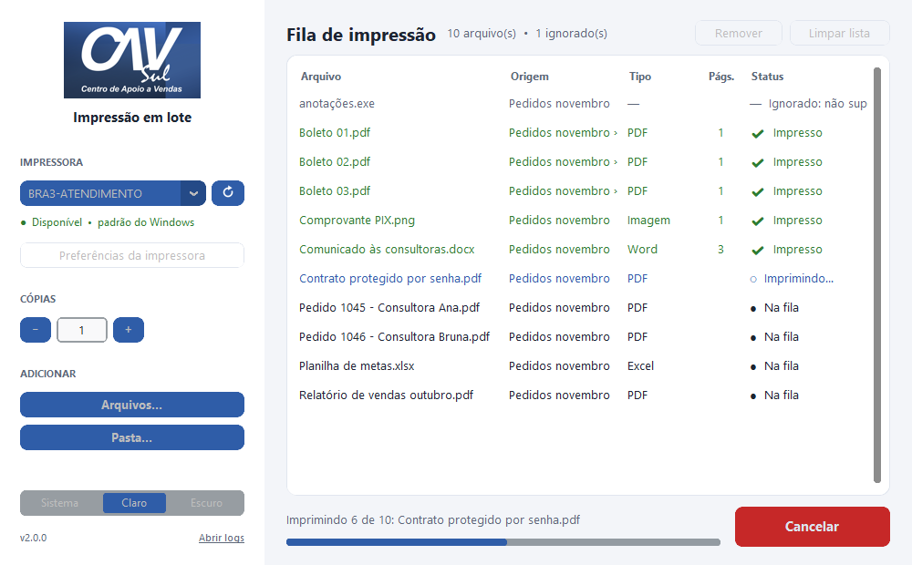
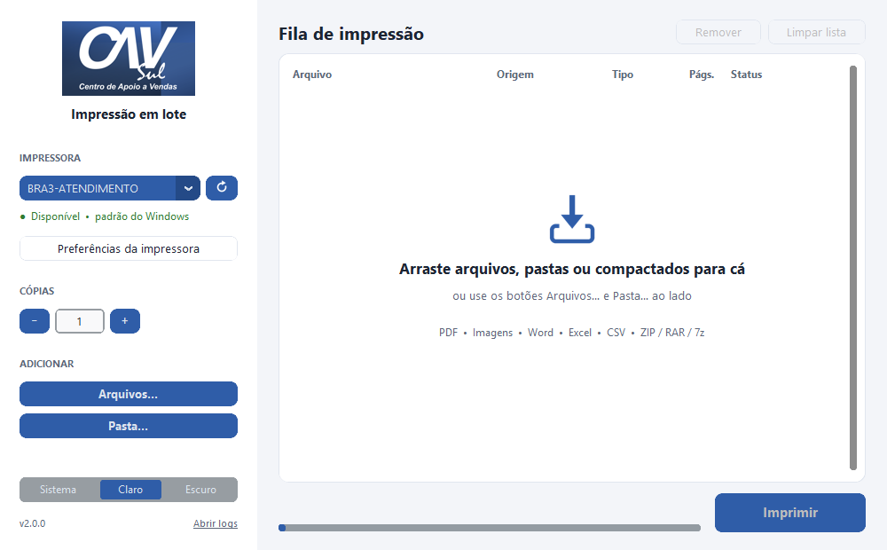
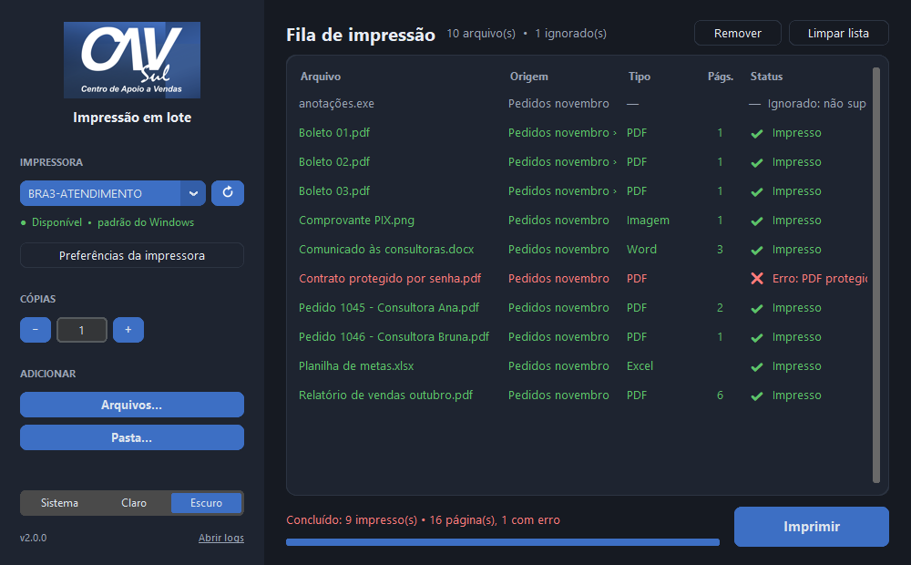

# Impressão CAV SUL

[](https://github.com/MichaelRodriguesOficial/printer/actions/workflows/ci.yml)


[](LICENSE)

Aplicativo para Windows que imprime **em lote** arquivos, pastas inteiras e compactados (.zip, .rar, .7z)
na impressora escolhida. Você monta a fila, confere o que vai sair e acompanha o status de cada arquivo.



## Funcionalidades

- **Arrastar e soltar** arquivos, pastas e compactados, ou usar os botões *Arquivos…* e *Pasta…*.
- **Fila de impressão** com status por arquivo (*Na fila*, *Imprimindo*, *Impresso*, *Erro*,
  *Ignorado*) e número de páginas. Dois cliques abrem o arquivo para conferir o conteúdo.
- **Compactados** extraídos automaticamente, inclusive com subpastas e zips dentro de zips.
- **Cópias**, **cancelamento** e **reimpressão só do que deu erro**.
- **Impressora padrão do Windows** já selecionada, **status da impressora** (offline, sem papel,
  porta aberta…) e acesso às **preferências** (frente e verso, cor, bandeja).
- Tema **claro, escuro ou do sistema**. O app lembra a última impressora, as cópias e o tema.
- **Log** para o suporte de TI, aberto pelo link *Abrir logs*.
- **PDF rápido (vetorial)**: o PDF vai para a impressora como texto e vetores, como no Foxit,
  com muito menos dados que uma imagem por página. A chave na barra lateral volta ao modo
  imagem se algum driver tiver problema.

| Tipo | Extensões | Como imprime |
|---|---|---|
| PDF | `.pdf` | PDFium (motor do Chrome) desenha direto na impressora em vetor; não depende do leitor de PDF instalado |
| Imagens | `.png .jpg .jpeg .jfif .bmp .gif .tif .tiff .webp` | Direto na impressora, ajustada à página, com rotação automática e fundo branco em transparências |
| Word | `.doc .docx .docm .rtf .odt .txt` | Microsoft Word (oculto, com macros desabilitadas); sem Office, pelo LibreOffice |
| Excel | `.xls .xlsx .xlsm .xlsb .csv .ods` | Microsoft Excel (oculto, com macros desabilitadas); sem Office, pelo LibreOffice |
| Compactados | `.zip .rar .7z .tar .tgz` | Extraídos e com o conteúdo adicionado à fila (`.rar`/`.7z` exigem o [7-Zip](https://7-zip.org)) |

<p>
  
  
</p>

## Download

Baixe o `PrinterCAV.exe` na página de [Releases](https://github.com/MichaelRodriguesOficial/printer/releases).
Não precisa instalar nada além dele.

## Executar pelo código-fonte

Requisitos: Windows 10/11 e Python 3.10 ou mais recente.

```powershell
git clone https://github.com/MichaelRodriguesOficial/printer.git
cd printer
python -m venv .venv
.venv\Scripts\activate
pip install -r requirements.txt
python main.py
```

Para testar a interface sem imprimir de verdade (também funciona fora do Windows), use `python main.py --demo`.

## Gerar o executável

```powershell
pip install -r requirements-dev.txt
python tools/build.py
```

O arquivo é gerado em `dist\PrinterCAV.exe` (arquivo único, com ícone e informações de versão).
Para conferir se o executável está íntegro, rode `PrinterCAV.exe --self-test`.

## Desenvolvimento

```powershell
pip install -r requirements-dev.txt
ruff check . ; ruff format --check .
pytest
```

- Os testes simulam o Windows (pywin32/COM) e rodam em qualquer sistema. Os testes de janela
  precisam de um display (no Linux, use `xvfb-run`).
- Os testes marcados como `windows` imprimem de verdade. No GitHub Actions é criada uma
  impressora virtual *Microsoft Print to PDF* que grava em arquivo, e o teste confere as páginas do
  PDF gerado. Para rodar localmente, defina `PRINTER_CAV_TEST_PRINTER` (e, opcionalmente,
  `PRINTER_CAV_TEST_OUTPUT`).
- `tools/benchmark_print.py "Impressora"` compara os modos de impressão de PDF (imagem x vetorial)
  e mede o ganho de reaproveitar a conexão no lote. Ele imprime de verdade, então use uma impressora
  virtual ou uma fila pausada. O CI roda esse benchmark em seis drivers do Windows.
- A cada push, o CI gera o `.exe`, roda o autoteste e anexa o executável e as capturas de tela aos
  artefatos. Ao criar uma tag `v*`, o `.exe` é publicado como release.

### Estrutura

```
main.py                    ponto de entrada (também usado pelo PyInstaller)
printer_app/
  files.py, archives.py    montagem da fila e extração segura de compactados
  printers.py              lista, status e preferências das impressoras do Windows
  jobs.py                  execução do lote em segundo plano (com cancelamento)
  printing/                impressão: gdi.py (PDF/imagens), pdf.py, images.py, office.py
  ui/                      interface (CustomTkinter)
  backend.py               Windows real ou modo demonstração
tests/                     testes automatizados (pytest)
tools/                     build do .exe e geração das capturas de tela
```

## Licença

[MIT](LICENSE) © Michael Rodrigues
